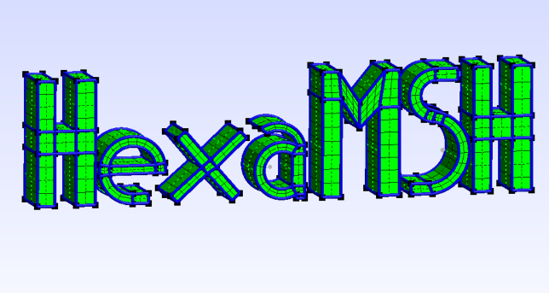

# HexaMSH

HexaMSH is a python library to generate structured hexahedral meshes for Finite Element Analysis.

It is based on the python API of gmsh and its GUI.

📖 Documentation: <https://opensource.michelin.io/HexaMSH/>

> **License notice:** Users of HexaMSH must comply with the BSD-3-Clause license for the HexaMSH layer ([LICENSE](LICENSE)) and the GNU GPL v2-or-later license for Gmsh ([license terms](https://gmsh.info/LICENSE.txt)).

## Getting started

For now, HexaMSH is not available through PyPI.

Please git clone the github project and locally install

`pip install .`

and then execute

`hexamsh my_cad.stp`

where `my_cad.stp` is the step file you want to mesh (it can either be a step, stp or brep).

Please work with only one CAD file per directory, otherwise HexaMSH will complain.

## Contributing

Contributions are welcome. Please read the [Contributing Guide](CONTRIBUTING.md) before
opening an issue or submitting a pull request. All contributors are expected to follow
the [Code of Conduct](CODE_OF_CONDUCT.md).
