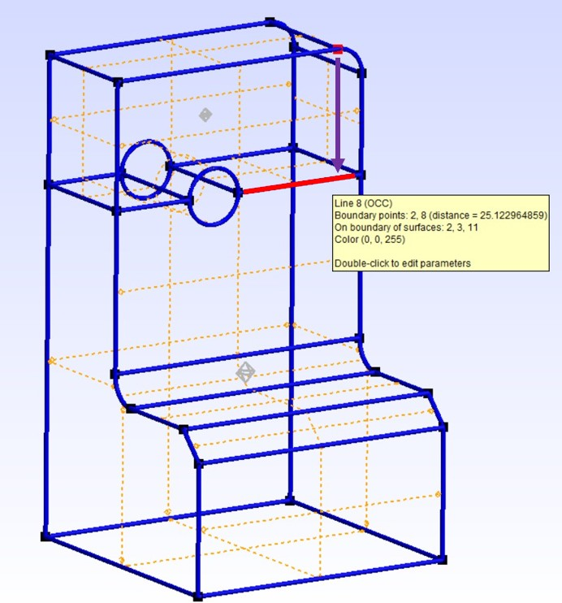
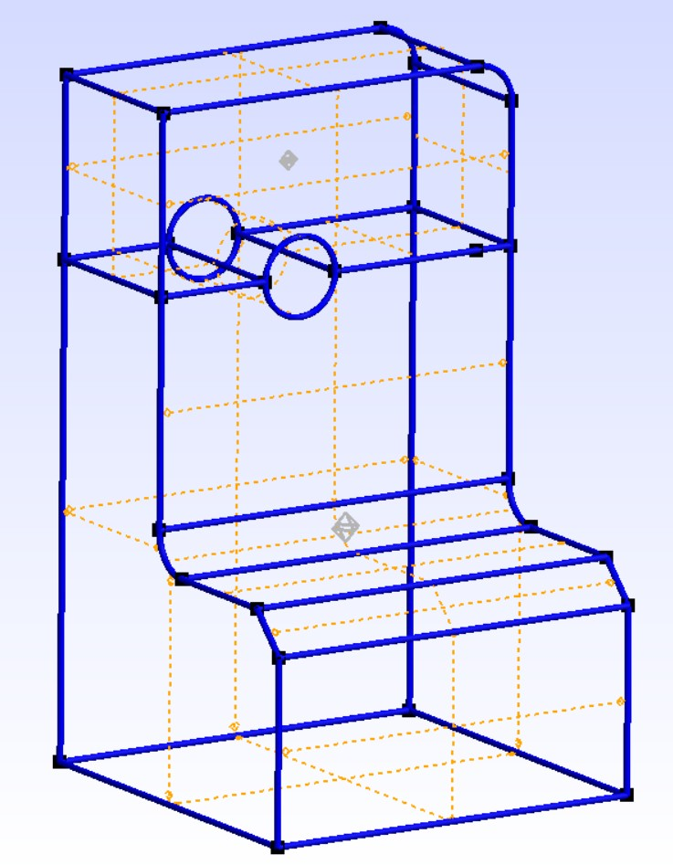

Projects an input point onto a target curve and returns the corresponding location on the curve (closest-point projection).

### Keyboard shortcut

- `P`

### What it does

Use this command when you have a point in space and need its equivalent position constrained to one or more curves.

### Inputs

- **1. Point**: the 2D/3D point to project.

- **2. Curve(s)**: one or more reference curves to project onto.

### Output

- One projected point is created on each selected curve.
- Topology is updated by fragmenting impacted surfaces.

### Basic usage

Run the command from the GUI `Geometry/Project/A point on a curve`, then select one point and one or more curves.

<figure markdown="span">
{width="300"}
</figure>

<figure markdown="span">
{width="300"}
</figure>

### Notes

- If multiple valid projections exist (e.g., near self-intersections), the nearest solution is typically chosen.
- Ensure the curve is valid and non-empty before projection.
- Numerical precision can affect results for very small or highly curved geometries.

