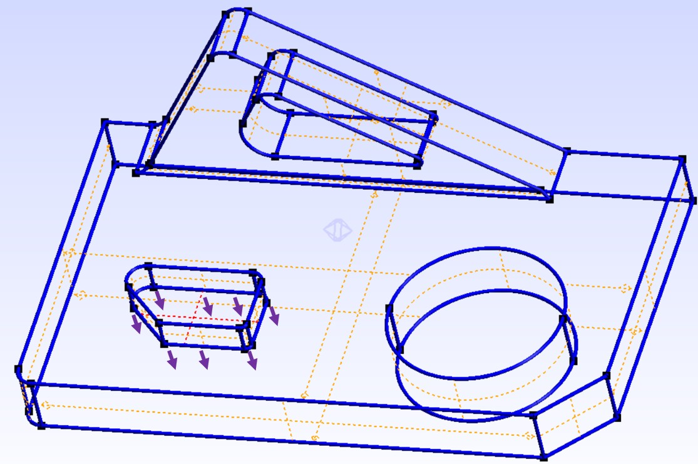
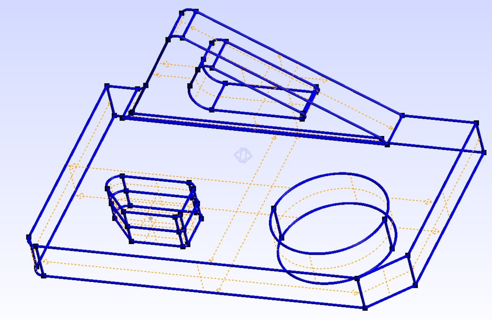

Projects an input surface toward a support surface and keeps intersected volumetric topology.

### Keyboard shortcut

- `S`

### What it does

Use this command when you need to project one surface toward another to partition or connect local topology.

### Inputs

- **1. Projected surface**: the source surface to be projected.
- **2. Support surface**: the target surface receiving the projection.

### Output

- Topology is updated after projection and intersection with the support surface.

### Basic usage

Run the command from the GUI `Geometry/Project/A surface on a surface`, then select the two surfaces.

<figure markdown="span">
{width="400"}
</figure>

<figure markdown="span">
{width="400"}
</figure>

### Notes

- This workflow is commonly used to partition holes before meshing.
