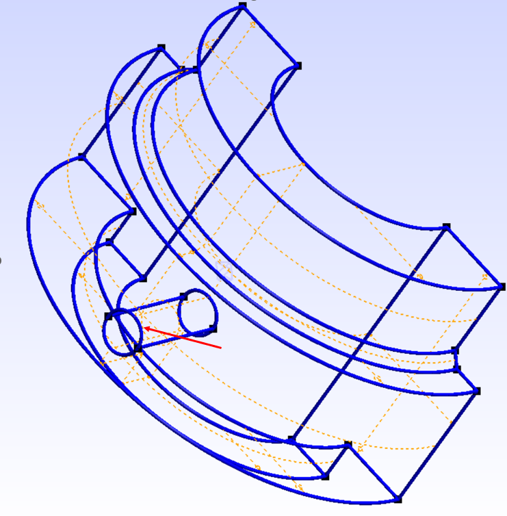
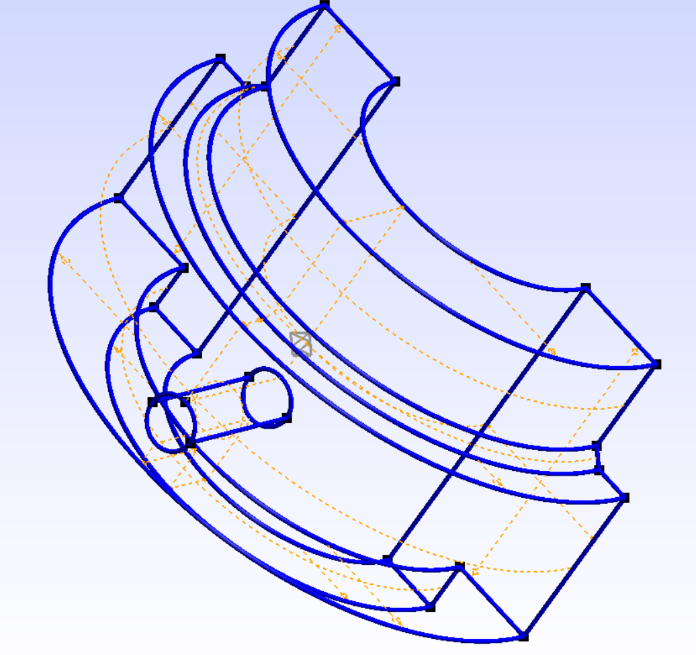

Adds one point on each selected curve at a given ratio.

### Keyboard shortcut

- `X`

### What it does

Use this command to insert point(s) on selected curve(s).
The point location is controlled by the GUI ratio parameter `Geometry/Add/A point on a curve (ratio)` in `[0, 1]`.
The ratio can now be adapted internally before geometry fragmentation to keep point insertion valid on impacted topology. Press `e` to validate the point(s) position.

### Inputs

- **1. Ratio**: normalized position on each selected curve (`0` at one end, `1` at the other end).
- **2. Curves**: one or more curves to process.

### Output

- A new point is added on each selected curve.
- The ratio may be adjusted before fragmentation when required by topology updates.
- Impacted surfaces are fragmented when needed to keep topology consistent.

### Basic usage

Run from the GUI with `Geometry/Add/A point on a curve (ratio)`, set the ratio, then select one or more curves.
If needed, the command adapts the ratio before fragmenting geometry and creating the final point(s).

<figure markdown="span">
{width="300"}
</figure>

<figure markdown="span">
{width="300"}
</figure>

### Notes

- A ratio of `0.5` corresponds to the midpoint along the chosen curve orientation.
- Selecting several curves applies the same ratio to all of them.
- In cases with topology changes, the effective insertion ratio can differ slightly from the requested value because it is adapted before fragmentation.
