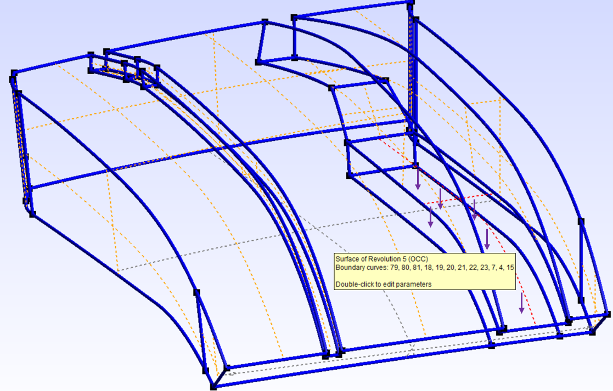

Adds side topology between two selected surfaces to form a closed volumetric region.

### Keyboard shortcut

- `D`

### What it does

Use `Add a volume between two surfaces` when you need to connect two surfaces and create the missing side faces between them.

The command:

- takes exactly two input surfaces,
- projects/links boundary points from the first surface to the second,
- creates missing side curves and side surfaces,
- updates topology by fragmentation where needed.

### Inputs

- **1. Surface #1**: source surface.
- **2. Surface #2**: target surface.

### Preconditions

For best results, the two selected surfaces should be geometrically compatible and represent boundaries that can be connected without ambiguity.

### Output

- New points/curves/surfaces are created as needed between the two selected surfaces.
- Intersected topology is fragmented and updated.

### Basic usage

Run from the GUI `Geometry/Add/A volume between two surfaces`, then select the two surfaces.

<figure markdown="span">
{width="300"}
</figure>

### Notes

- The operation may reuse existing linking curves when present.
- The two selected surfaces must be different.

