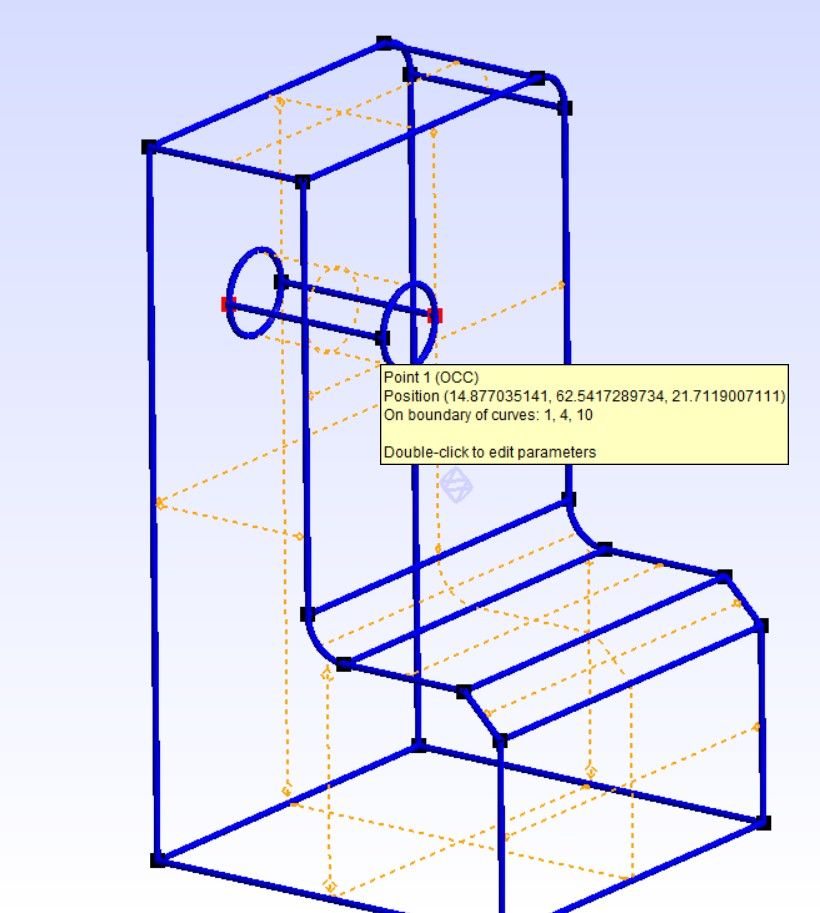
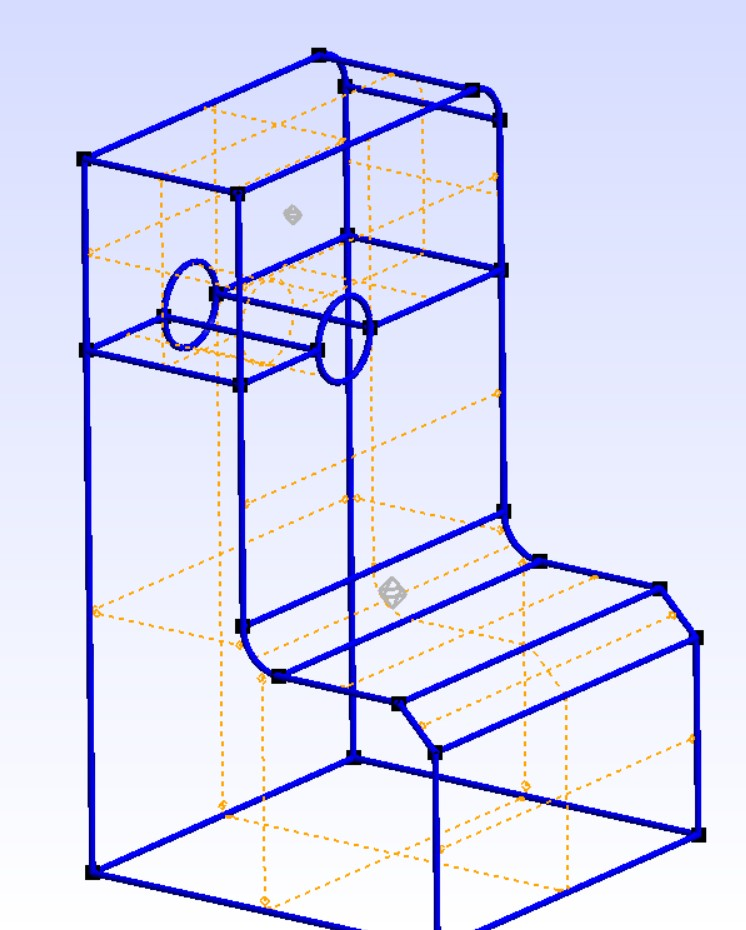

Splits intersected volumes using an infinite cutting plane defined by three non-collinear points.

### Keyboard shortcut

- `M`

### What it does

Use this command when you need to cut volumes by an explicit infinite geometric plane.
The plane is built from three points and applied to intersected volumes.

### Inputs

- **1. Point A**: first point defining the split plane.
- **2. Point B**: second point defining the split plane.
- **3. Point C**: third point defining the split plane.

### Output

- Original volumes are split where they intersect the plane.
- New volume parts are created on each side of the plane.
- Volumes not intersecting the plane are unchanged.

### Basic usage

Run the command from the GUI `Geometry/Split by/ An infinite plane (3 points)` and select the three points.

<figure markdown="span">
{width="300"}
</figure>

<figure markdown="span">
{width="300"}
</figure>

### Notes

- The three points must be distinct and non-collinear.
- A split occurs only for volumes intersected by the plane.
