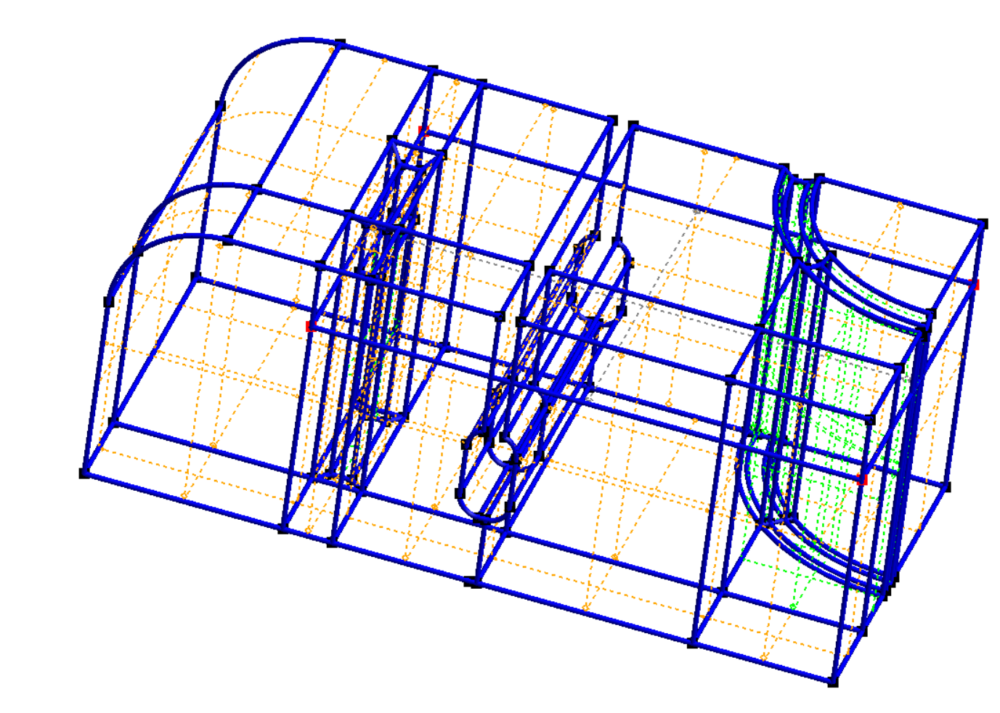

Splits intersected volumes using a finite cutting surface defined by four points.

### Keyboard shortcut

- `K`

### What it does

Use this command when you need to cut volumes with a bounded (finite) planar patch.
The command builds a finite surface from points **A**, **B**, **C**, and **D**, then applies it to intersected volumes.

### Inputs

- **1. Point A**: first point defining the finite surface.
- **2. Point B**: second point defining the finite surface.
- **3. Point C**: third point defining the finite surface.
- **4. Point D**: fourth point defining the finite surface.

### Output

- Intersected volumes are split by the finite surface.
- New volume parts are created where intersections exist.
- Volumes not intersecting the finite surface remain unchanged.

### Basic usage

Run from the GUI `Geometry/Split by/ A finite surface (4 points)` and select four points.

<figure markdown="span">
{width="300"}
</figure>

### Notes

- The four points should define a valid planar boundary in practice.
- A split occurs only for volumes intersected by the finite surface.
