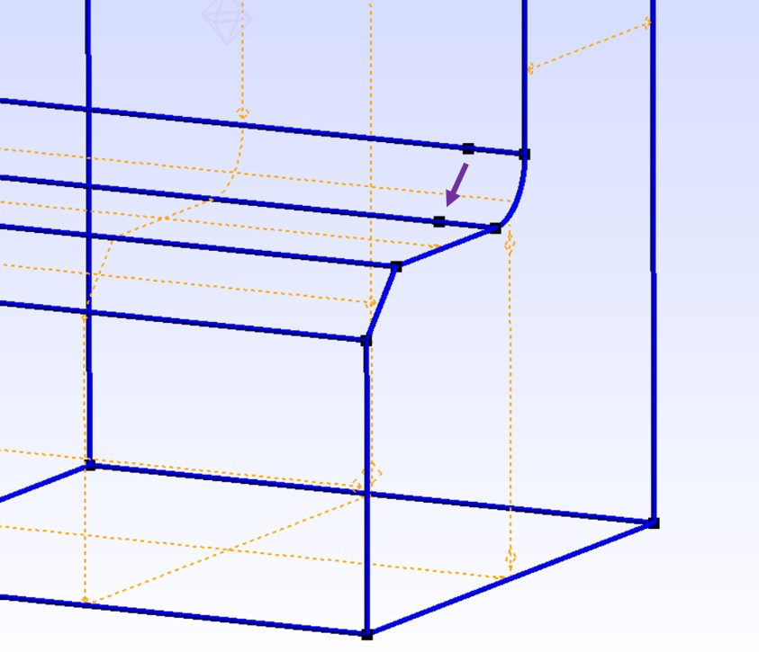
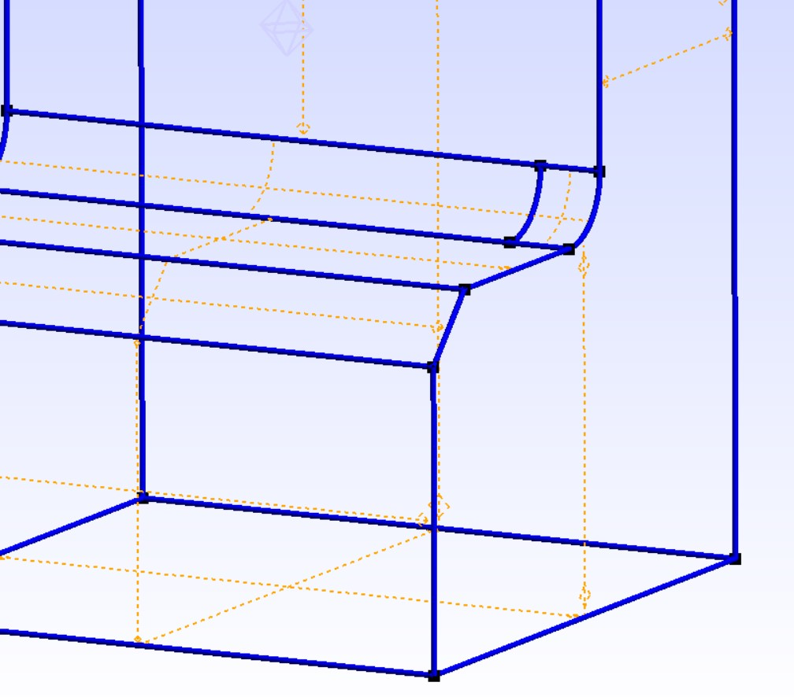

Creates a new geometric curve entity from user-provided points.

### Keyboard shortcut

- `Y`

### What it does

Use this command to define a curve directly in the model.  
The command reads two points and optionally one pattern curve to guide interpolation.

### Inputs

- **1. Point A**: First point used to construct the curve.
- **2. Point B**: Second point used to construct the curve.
- **3. Pattern curve**: optional guide curve for the new curve shape.

### Output

- A new curve entity is added to the model and split the surface connecting the two points.

### Basic usage

Run from the GUI `Geometry/Split/A surface by a curve` and provide the requested selections.

<figure markdown="span">
{width="300"}
</figure>

<figure markdown="span">
{width="300"}
</figure>

!!! tip "Remark"
    It is only possible to create a curve on a unique support surface. The selected points must lie on the same surface.

### Notes

- Two distinct points are required.
- A single optional pattern curve can be used to guide the creation of the new curve.
