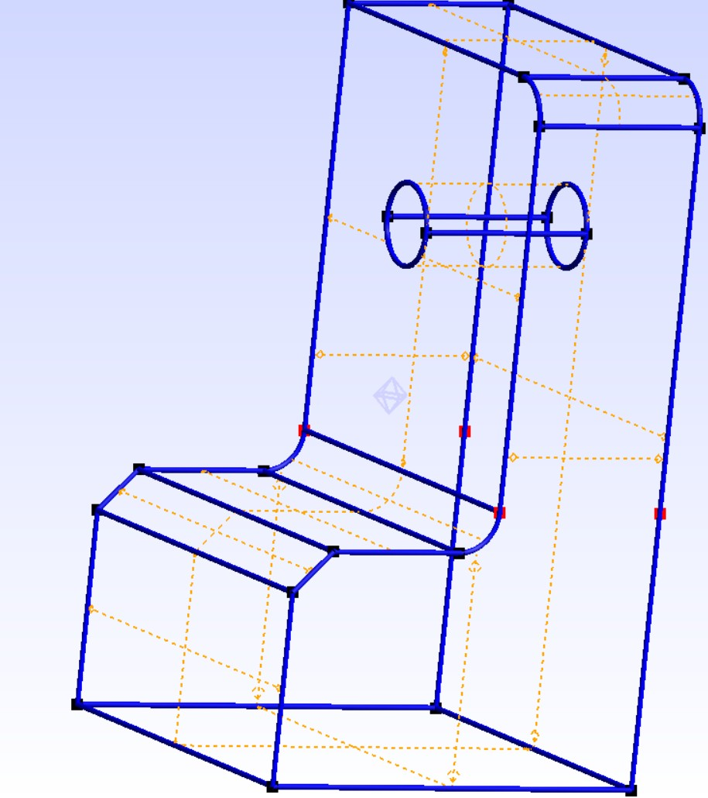
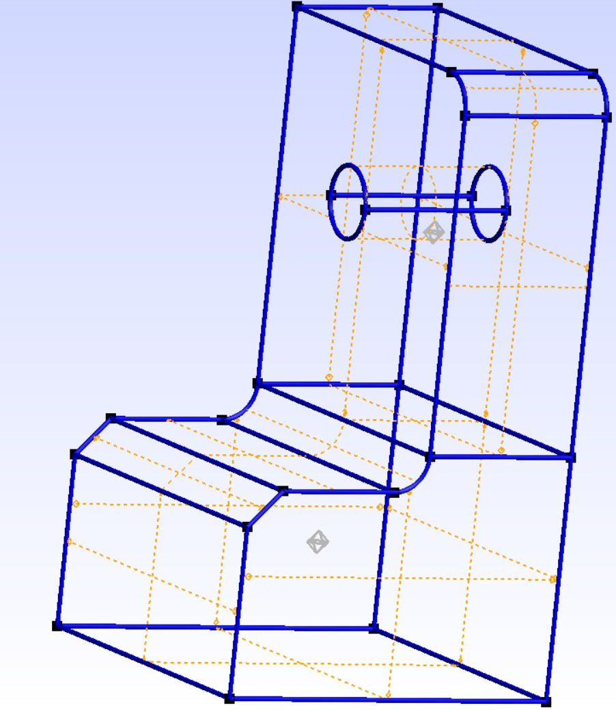

Splits target volumes using a closed point loop as the cutting profile.

### Keyboard shortcut

- `L`

### What it does

Use this command when you need to split volumes from a user-defined point-loop boundary.
The loop is used as the split definition and applied to intersected volumes.

### Inputs

- **1. Point loop**: a valid closed loop of connected points defining the split boundary. Click twice on the latest point to end the selection.

### Output

- Original volumes are split where they intersect the point-loop-defined cutting geometry.
- New volume parts are created from the split.
- Volumes not intersecting the split definition are unchanged.

### Basic usage

Run the command from the GUI `Geometry/Split by/ A point loop`, then select a closed loop of points.

<figure markdown="span">
{width="300"}
</figure>

<figure markdown="span">
{width="300"}
</figure>

### Notes

- The point loop must be closed and geometrically valid.
- The point loop must entirely cut a volume to truly generate two new volumes.
- The point loop can contain any number of points.