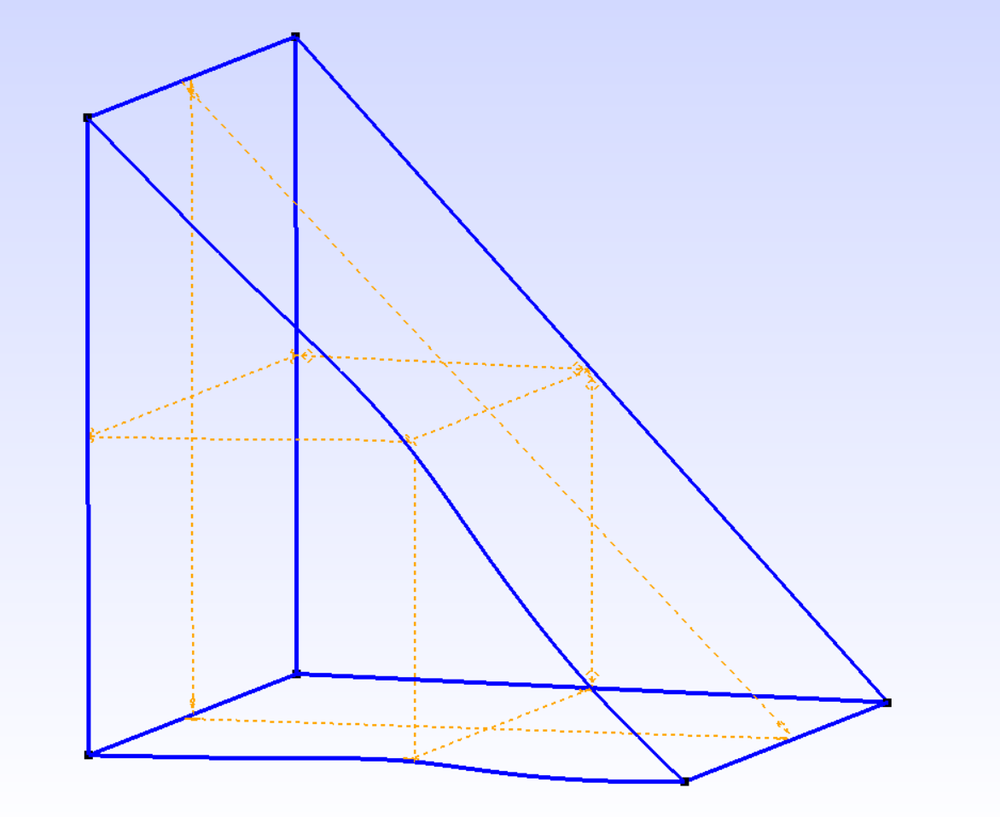
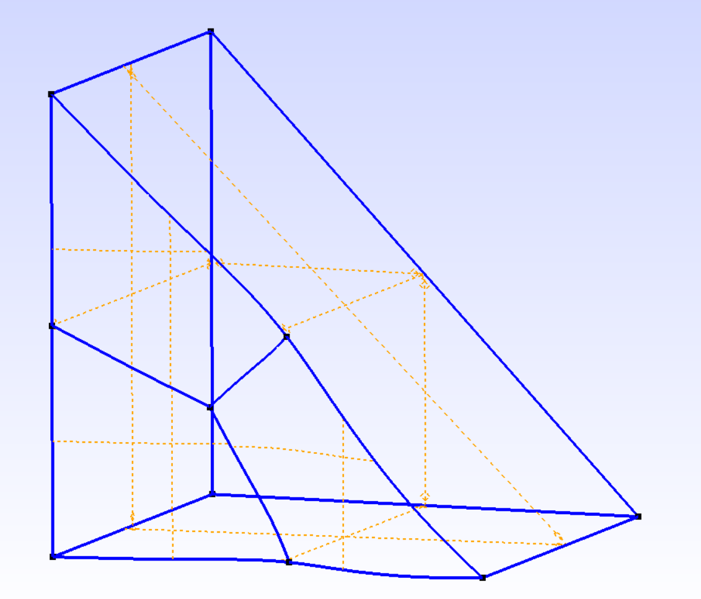

Splits an existing triangular surface into smaller quadrilateral surfaces.

### Keyboard shortcut

- `U`

### What it does

Use this command to split a triangular surface by inserting:
- a split point at the midpoint of each edge,
- a central point at the barycenter of these split points.

The original triangle is replaced by new quadrilateral surfaces sharing the new split topology.

<figure markdown="span">
{width="300"}
</figure>

<figure markdown="span">
{width="300"}
</figure>

### Inputs

- **1. Triangle surface**: the target surface to split (must be triangular).

### Output

- The selected triangular surface is split into multiple quadrilateral surfaces.
- Required internal curves/edges are created automatically.
- Topology is updated so the new surfaces remain connected to neighboring entities.
- Invalid split attempts are rejected (for example, non-triangle targets or invalid split location).

### Basic usage

Run the triangle-splitting command from the GUI, then select a triangular surface.

### Notes

- Only triangle surfaces are supported by this command.
- This operation is useful for ensuring valid blocking, since triangles are not well suited to transfinite strategies.
