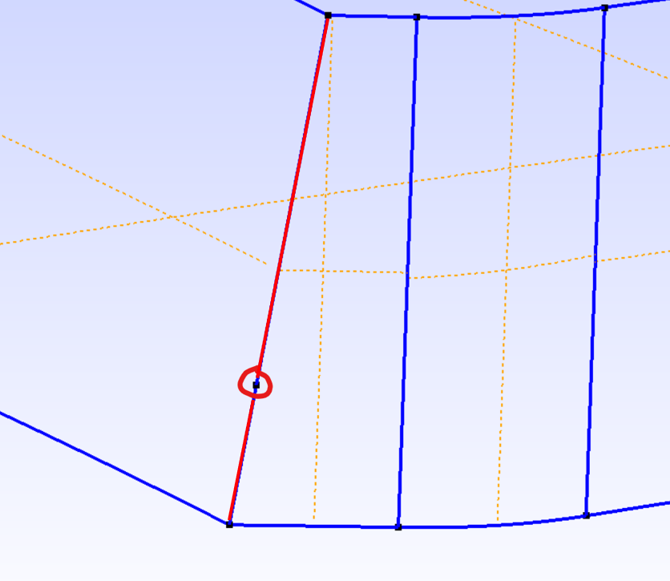

Merges two compatible curve entities into a single curve.

### Keyboard shortcut

- `C`

### What it does

Use `Merge 2 curves` to simplify geometry when two neighboring curves should behave as one (for example after partitioning, imprinting, or cleanup operations).

The command:

- takes exactly two input curves,
- checks merge compatibility (topology/geometry),
- removes the internal boundary (point) between them when possible,
- creates one merged curve entity.

### When to use it

Use this command when:

- two curves are part of the same physical face but were split earlier,
- meshing constraints should be applied on one unified curve,
- downstream operations require a single continuous curve.

### Inputs

- **1. Curve 1**: Curve one to be merged.
- **2. Curve 2**: Curve two to be merged.

### Preconditions

For a successful merge, the two selected curves should typically:

- share a common point/boundary,
- be geometrically compatible (same underlying support or mergeable representation),
- belong to the same model context/body rules supported by HexaMSH.

If these conditions are not met, HexaMSH can return an error or an invalid/degraded CAD result.

### Output

- One new merged curve replaces the two input curves.
- Shared internal boundary (point) is removed.

### Basic usage

Run from the GUI `Geometry/Merge/Two Curves`, then select the two curves.

<figure markdown="span">
{width="300"}
</figure>

### Notes

- Merge operation is local: only the two selected curves are processed.
- Perform merge before any other CAD modification and mesh sizing when possible, to avoid rework.

