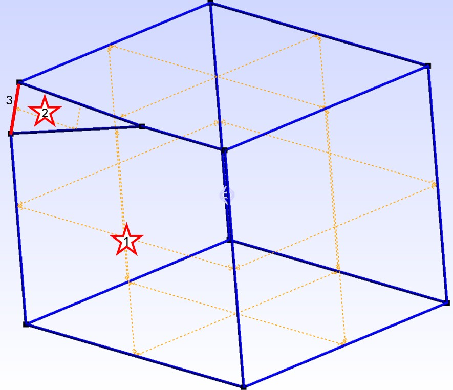
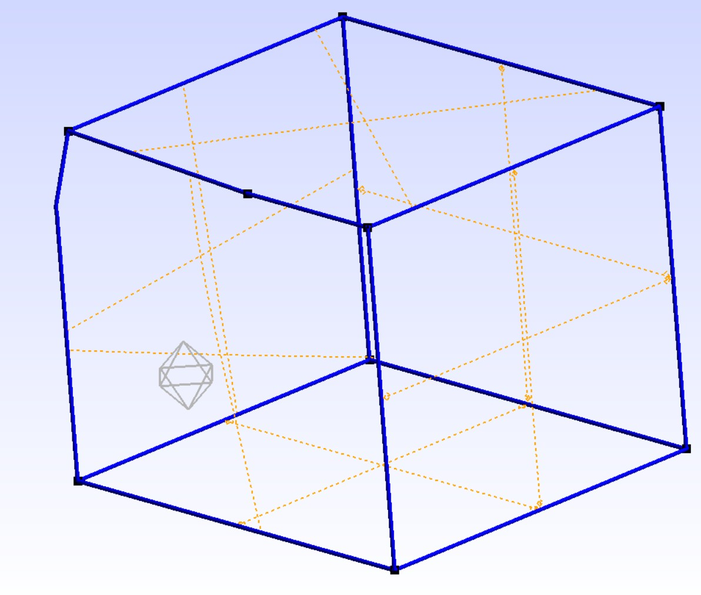

Merges two compatible surface entities into a single surface.

### Keyboard shortcut

- `V`

### What it does

Use `Merge 2 surfaces` to simplify geometry when two neighboring surfaces should behave as one (for example after partitioning, imprinting, or cleanup operations).

The command:

- takes exactly two input surfaces,
- checks merge compatibility (topology/geometry),
- removes the internal boundary between them when possible,
- creates one merged surface entity.

If one or both surfaces are bounded by exactly 3 curves, you can provide the curve to remove on each triangular surface.

### When to use it

Use this command when:

- two surfaces are part of the same physical face but were split earlier,
- meshing constraints should be applied on one unified surface,
- downstream operations require a single continuous surface.

### Inputs

- **1. Surface #1**: first surface to merge.
- **2. Surface #2**: second surface to merge.
- **3. Curve 1**: curve on the first surface to remove when that surface has 3 boundary curves.
- **4. Curve 2**: curve on the second surface to remove when that surface has 3 boundary curves.

### Preconditions

For a successful merge, the two selected surfaces should typically:

- share a common curve/boundary,
- be geometrically compatible (same underlying support or mergeable representation),
- belong to the same model context/body rules supported by HexaMSH.

If these conditions are not met, HexaMSH can return an error or an invalid/degraded CAD result.

### Output

- One new merged surface replaces the two input surfaces.
- Shared internal boundaries (curve and points) are removed.

### Basic usage

Run from the GUI `Geometry/Merge/Two Surfaces`, then select the two surfaces.
If prompted for triangular cases, select the curve to remove on each relevant surface.

<figure markdown="span">
{width="300"}
</figure>

<figure markdown="span">
{width="300"}
</figure>

In the example above, a curve is explicitly selected for a surface with 3 boundary curves.

### Notes

- Merge operation is local: only the two selected surfaces are processed.
- Perform merge before any other CAD modification and mesh sizing when possible, to avoid rework.

