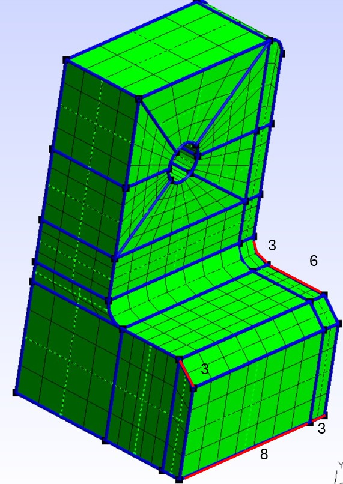

### Keyboard shortcut

- `N`

### What it does

This feature sets the **target number of nodes (points)** on a selected edge.  
In HexaMSH, this controls edge discretization for structured/transfinite meshing so adjacent faces can be generated with consistent divisions.

Use it when you need exact control over mesh density along specific edges.

### Basic usage

1. Run **Mesh/Set number of nodes on /One edge**.
2. Select one or more edges.
3. Enter the desired node count (integer).

HexaMSH automatically re-meshes the model.

<figure markdown="span">
{width="300"}
</figure>

### Inputs

- **1. Curve**: the reference curve on which we set the number of nodes.
- **2. Node count**: integer number of nodes.

### Output

- The CAD meshed with the new rule (number of nodes on a specific edge).

### Notes

- Higher values create a finer mesh along the selected edge.
- HexaMSH automatically updates related edges as needed, because Gmsh requires matching node counts on opposite curves for transfinite meshing.
- If you run the command again, the new value overwrites the previous one.
