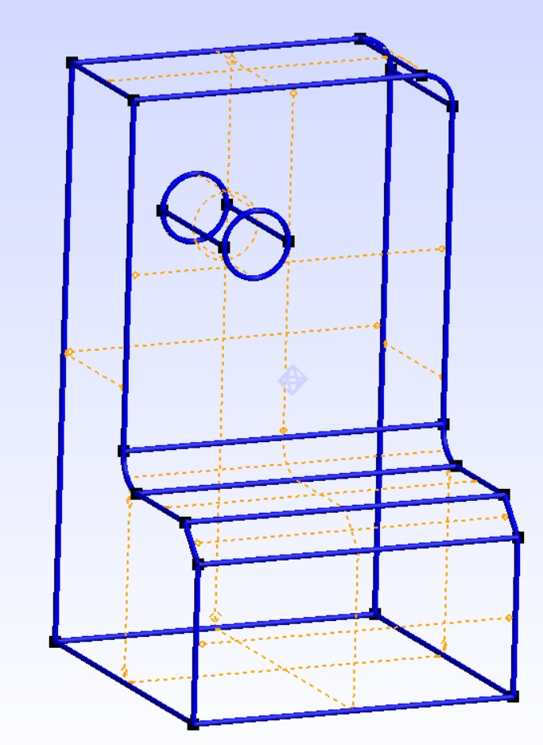
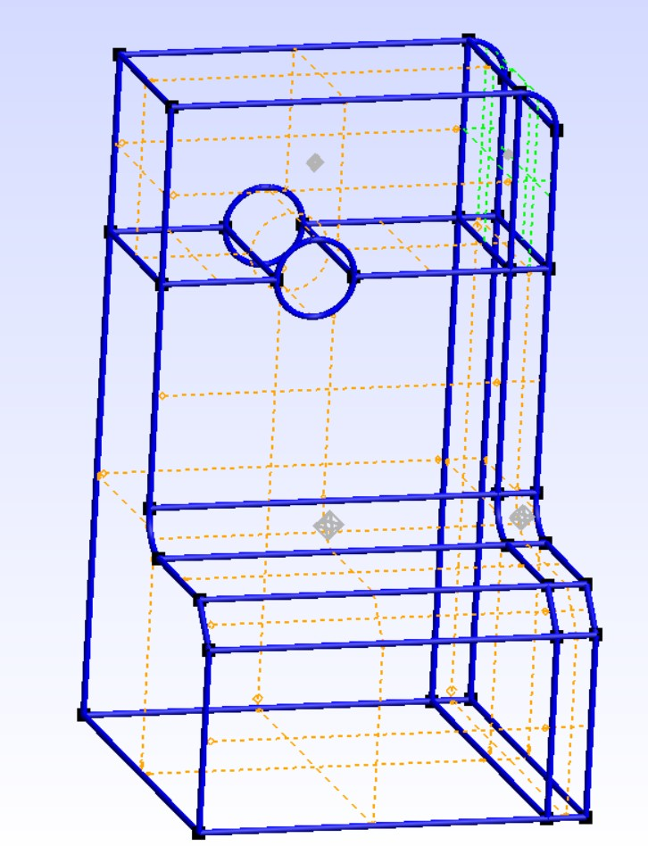
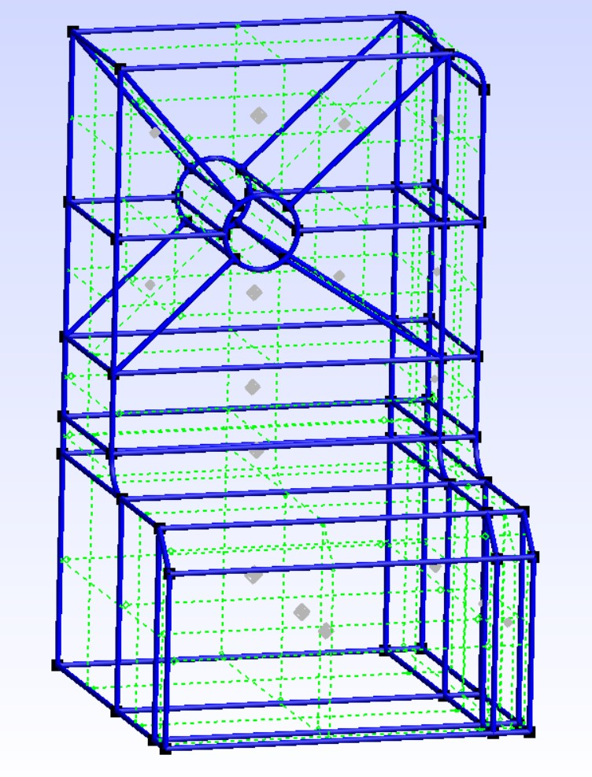
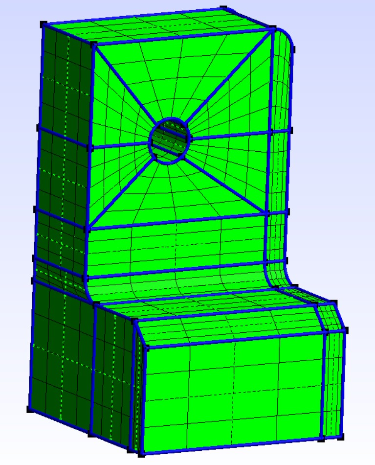

# HexaMSH 1.0.1

HexaMSH is a Python library and CLI tool to generate structured hexahedral meshes for Finite Element Analysis (FEA).  
It is built on top of the Gmsh Python API and GUI.

## Getting started

Install HexaMSH from [PyPI](https://pypi.org/project/hexamsh/):

`pip install hexamsh`

You can start by playing the three tutorials available here:

- [Workpiece1](tutorials/01_tutorial_workpiece_1/)
- [Workpiece2](tutorials/02_tutorial_workpiece_2/)
- [Workpiece3](tutorials/03_tutorial_workpiece_3/)

## Principle

HexaMSH aims at partitioning a geometry into sub-volumes. The geometry editing features available in the GUI are listed below:

- [Back to previous CAD](commands/00_back_to_previous_cad/)
- [Project a point on a curve](commands/01_project_point_on_curve/)
- [Project a surface on a surface](commands/02_project_surface_on_surface/)
- [Add a point on a curve](commands/03_add_a_point_on_curve/)
- [Add a surface by curve loop](commands/04_add_a_surface_by_curve_loop/)
- [Add a surface by point loop](commands/05_add_a_surface_by_point_loop/)
- [Add a volume between two surfaces](commands/06_add_a_volume_between_two_surfaces/)
- [Split all volumes by a plane (3 points)](commands/07_split_all_volumes_by_plane_3_points/)
- [Split all volumes by a finite surface (4 points)](commands/08_split_all_volumes_by_surface_4_points/)
- [Split a surface by a curve](commands/09_split_surface_by_curve/)
- [Split a volume by a point loop](commands/10_split_volume_by_point_loop/)
- [Split a triangle surface](commands/11_split_a_triangle_surface/)
- [Split a wedge volume](commands/12_split_a_wedge_volume/)
- [Merge 2 curves](commands/13_merge_two_curves/)
- [Merge 2 surfaces](commands/14_merge_two_surfaces/)
- [Remove all duplicates](commands/15_remove_all_duplicates/)
- [Remove curves](commands/16_remove_curves/)
- [Remove orphan curves](commands/17_remove_orphan_curves/)
- [Remove surfaces](commands/18_remove_surfaces/)

At startup, the initial CAD is composed of one volume bounded by multiple surfaces:

<figure markdown="span">
{width="300"}
</figure>

All surfaces appear orange, as not meshable with the transfinite method provided by Gmsh. Thanks to the different geometry features, the user can split the volume into sub-volumes.

While a sub-volume is composed by 6 surfaces, Gmsh is able to mesh according to the transfinite method. That volume appears green in the GUI:

<figure markdown="span">
{width="300"}
</figure>

The target is to partition the geometry into multiple sub-volumes with 6 surfaces:

<figure markdown="span">
{width="300"}
</figure>

When all volumes are green, click **Mesh CAD** to generate a 3D structured hexahedral mesh:

<figure markdown="span">
{width="300"}
</figure>

By default, all the edges are meshed by the transfinite method with 5 nodes.

You can then modify the mesh, through the GUI, with:

- [Set number of nodes on one edge](commands/19_set_number_of_nodes_on_edges/)
- [Set number of nodes on all edges](commands/20_set_number_of_nodes_on_all_edges/)


## Command-line usage

Run HexaMSH from a terminal:

```bash
hexamsh <study_name>
```

Where `study_name` is the base name of the STEP file to open (HexaMSH reads `<study_name>.stp/step` or `<study_name>.brep`).

## Replay feature 

HexaMSH writes GUI geometry and meshing actions to a `replay.py` script.  
This script provides reproducibility and lets you run the same workflow again programmatically.

### Replay File Location

`replay.py` is automatically created and updated in the directory that contains the STEP CAD file.

### Replay to Resume GUI Operations

You can replay the script from the GUI to continue a previously executed hex-meshing process.

!!! note "Remark"
     `replay.py` is also used for partial replay when [undoing the latest operation in the GUI](00_back_to_previous_cad/).

### Replay on Parametric CAD Variants

If you generate multiple CAD models with the same topology (parametric variants), you can replay the same script for each model:

```bash
python replay.py
```

This is useful to automate mesh generation for design-of-experiments workflows.
